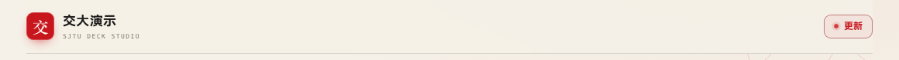
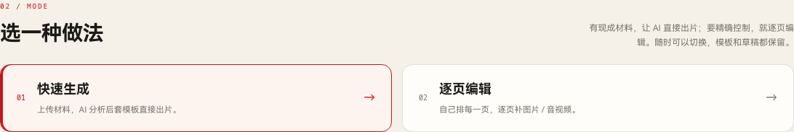
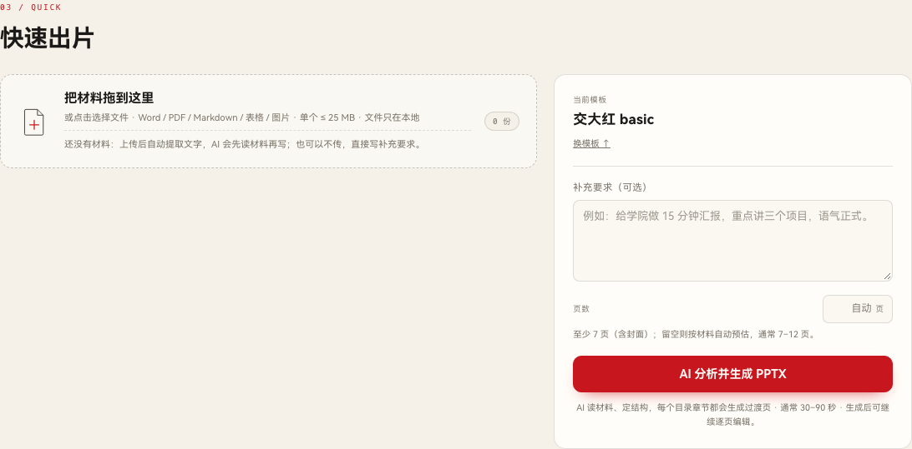
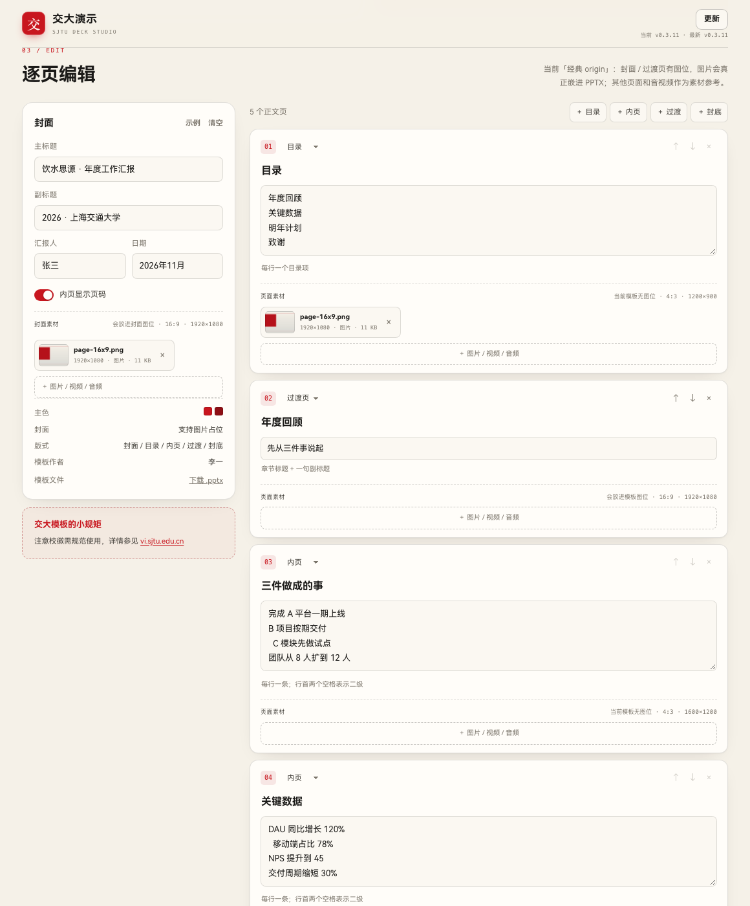
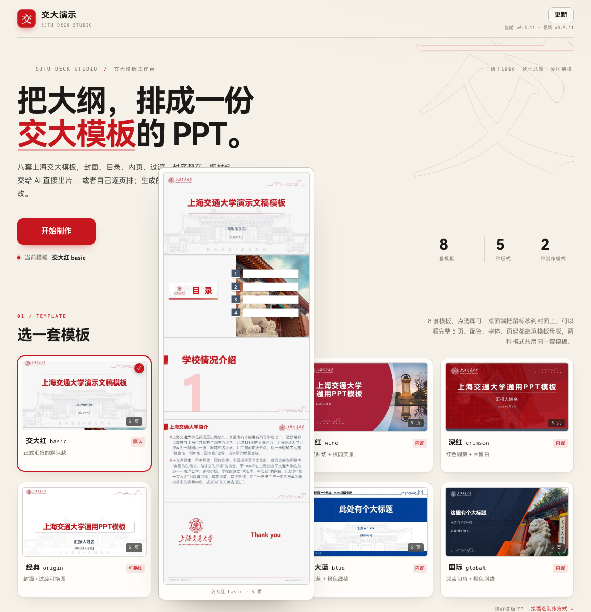

# 交大演示 · dsh-sjtu-ppt

把 **SJTU-PPT-Skill** 的八套上海交大模板装进 DeepSeek Harness：侧栏多一个「交大演示」入口。可以做两种事：把材料交给 AI 直接出片，或者逐页编辑；生成的 `.pptx` 都能继续改。

- 左侧栏入口，页面在 iframe 里，明暗跟随 DSH
- 8 套内置模板：basic / 130 / wine / crimson / origin / star / blue / global
- 5 种版式：封面、目录、内页、过渡页、封底
- 模板永远在第一个版块；两种模式共用同一套模板和草稿
- 快速生成：材料 → AI 分析 → 套模板直接出片，面板内一键生成，不跳对话
- 逐页编辑：自己排封面和每一页；封面 / 目录 / 内页 / 过渡 / 封底都有素材位，可传图片、视频、音频
- 图片会显示实际尺寸和建议比例；`origin` 的封面 / 过渡图位会真正嵌入图片，音视频作为素材参考保留
- 生成后可直接下载、在 Finder 中定位；「最近生成」保留历史
- 注册 `sjtu-ppt` 技能和 `sjtu_ppt_generate` 工具，对话里也能生成并交付
- 使用 DSH 桌面版自带的 Python（含 python-pptx），不额外装依赖
- 界面字体使用 HarmonyOS Sans SC（Regular / Bold）
- 已在 DSH 0.2.1-rc.5 + python-pptx 1.0.2 下验证：真实侧栏入口、快速生成、逐页素材、下载都通过


## 安装

### 从 GitHub 安装（推荐）

仓库：**https://github.com/yourworld2/dsh-sjtu-ppt**

DSH → 左侧 **Plugins** → **Add plugin** → 填上面的地址 → **Install** → 刷新页面。侧栏会出现「交大演示」。

### 从本地目录安装

解压分享包，或直接用仓库目录。在 **Plugins → Add plugin** 里选这个目录：

```
<你存放插件的路径>/dsh-sjtu-ppt
```

安装后确认它出现在该 profile 的组合包列表里（`dsh.profile.bundles`）。侧栏出现「交大演示」即可。

> 开发时可以用 `link:` 装；也可以把仓库打成 zip / tgz 发给同事。

### 手动安装

```sh
cd ~/.dsh/profiles/desktop
node "/Applications/DeepSeek Harness.app/Contents/Resources/runtime/primary-runtime/dependencies/pnpm/bin/pnpm.cjs" \
  add "link:/绝对路径/dsh-sjtu-ppt"
```

然后把 `dsh-sjtu-ppt` 加进 `package.json` 的 `dsh.profile.bundles`：

```json
{
  "dsh": {
    "profile": {
      "bundles": [
        "@deepseek-ai/dsh-base",
        "@deepseek-ai/dsh-web-app",
        "dsh-guizang-design",
        "dsh-sjtu-ppt"
      ]
    }
  }
}
```

有 HMR 时组合包列表变化会直接重组；没有 HMR 时重启 DSH。浏览器端模块在页面刷新后加载。

## 更新

插件首页右上角有「更新」按钮：

- 打开页面时会读取 GitHub `main` 分支的 `package.json` 版本；比当前安装新时，按钮出现红点，悬停显示「发现新版本 vX（当前 vY）」。
- 点击会打开一个新对话，输入框预填下面这句，不会自动发送：

  ```
  根据 https://github.com/yourworld2/dsh-sjtu-ppt ，帮我更新已有的插件。
  ```

  发送后由 AI 读取仓库并更新插件。
- 作者发版时需要同时修改 `package.json` 的 `version` 并 push，红点才会出现；只改代码不改版本不会提示。
- 每 10 分钟检查一次；网络不通时静默失败，按钮仍然可以点。
- 更新完成后按 DSH 提示重启/刷新；材料和已生成文件在 `~/.dsh/sjtu-ppt`，不会丢。
- **0.3.4 之前的旧版没有这个按钮**，同事需要先手动重装一次到 0.3.4 或更高；之后就能用按钮。



## 两种做法



### 快速生成

适合手里已经有 Word、PDF、大纲或数据表的情况：

1. 在 **01 / TEMPLATE** 选一套模板。
2. 在 **02 / MODE** 选「快速生成」。
3. 把材料拖进材料台；页数可以留空（AI 按材料自动预估，通常 7–12 页），也可以填 7–20 之间的数字。补一句要求（听众、场合、重点）也可以。
4. 点「AI 分析并生成 PPTX」。插件直接调用当前 DSH 默认模型：读材料、定结构、套模板、生成文件，通常 30–90 秒。页数留空时，模型会先按材料信息量判断合理页数，再组织内容；填写时按填写的页数裁切。结果在面板里直接弹下载，不会跳到一个新对话。
5. 结果弹窗里点「带入逐页编辑」，这份结构会写回编辑器继续改；图片以生成的 PPT 为准。



快速模式会用你上传的全部材料做上下文（最多 6000 字摘录 + 全文路径），并把图片按顺序放进 `origin` 模板的封面 / 过渡页图位。没有模型或材料读不出文字时，会直接提示。

目录里的每个章节都会生成一张自己的过渡页（`section`），不会再用一张过渡页覆盖多个章节；页数会自动把每章的过渡页算进去。

### 逐页编辑

适合需要精确控制每一页的情况：

1. 选「逐页编辑」，封面和每一页都会出现素材位。右侧说明会跟着模板更新：origin 有图位，其他模板只作素材参考。
2. 点「＋ 图片 / 视频 / 音频」或把文件拖进去；图片会显示 `1920×1080` 这样的实际尺寸。
   - 目录分成多个章节时，每章前用「＋ 过渡」加一张同名过渡页；快速模式会自动补齐，逐页编辑需要手动加。
3. 每个版式都有建议比例：封面 / 过渡 / 封底 16:9，目录 4:3，内页 4:3。
4. `origin` 模板的封面 / 过渡页有图片占位，上传图片会真正嵌进 `.pptx`；其他模板或页面没有图位，图片作为素材参考保留。音视频不会自动嵌入。
5. 点「生成 PPTX」，下载或在 Finder 中定位。



## 用

### 在对话里直接用

技能名：`sjtu-ppt`；工具名：`sjtu_ppt_generate`。工具参数：

```json
{
  "template": "wine",
  "content": { "title": "...", "slides": [] },
  "output": "/绝对路径/演示.pptx"
}
```

`output` 建议给当前工作区的绝对路径；不给就落在 `$DSH_HOME/sjtu-ppt/out/`。

## 材料

- **快速模式材料台**：Word（docx / doc / rtf）、PDF、Markdown / 文本 / CSV / JSON、PPT / PPTX、Excel / XLSX、图片，单个 ≤ 25 MB。拖入或点击选择，文字自动提取，点「看全文」检查。
- **逐页素材**：图片（png / jpg / webp / gif）、视频（mp4 / mov / webm / m4v）、音频（mp3 / wav / m4a / aac / ogg），单个 ≤ 25 MB；上传时会记录图片宽高。
- 所有文件只留在本机：`~/.dsh/sjtu-ppt/materials/<id>/`（原文件 + `text.txt` + `meta.json`），不上传云端。材料台和逐页素材用 `scope` 区分，互不混在一起。
- 快速模式会把材料摘录和全文路径放进模型提示词。
- `origin` 模板的封面 / 过渡页有图片占位，图片会嵌入；其他模板或页面没有图位，图片只作为素材参考。音视频不会自动嵌入 `.pptx`。
- 旧版 `.ppt` / `.xls` 可以上传，但取字会提示另存为 `.pptx` / `.xlsx`。

## 模板

| id | 名称 | 特点 |
| --- | --- | --- |
| `basic` | 交大红 | 校门线稿、交大红主色，默认款 |
| `130` | 校庆130 | 校庆红横线，正式典礼 |
| `wine` | 酒红 | 酒红斜切 + 饮水思源碑实景 |
| `crimson` | 深红 | 红色圆弧、大留白 |
| `origin` | 经典 | 封面 / 过渡页支持图片占位 |
| `star` | 星图 | 星空长曝光 + 暖橙 |
| `blue` | 交大蓝 | 交大蓝 + 粉色线稿 |
| `global` | 国际 | 深蓝切角 + 橙色斜线 |

内置模板没有「左 / 右」占位符，`left` / `right` 双栏字段只对用户自带的 `.pptx` 模板生效。


模板卡片的缩略图在 `web/assets/thumbs/`，文件名与 `skills/sjtu-ppt/assets/*.pptx` 一一对应：`SJTU-wine.pptx` → `SJTU-wine.jpg`。8 张卡按 4×2 矩阵排列，默认只露封面 16:9；桌面端悬停时在卡片旁浮出完整 5 页长图，不改变网格布局。替换同名图片即可换缩略图。



## 内容 JSON

```json
{
  "title": "饮水思源 · 年度工作汇报",
  "subtitle": "2026 · 上海交通大学",
  "author": "张三",
  "date": "2026年11月",
  "page_numbers": true,
  "slides": [
    { "layout": "toc", "title": "目录", "content": ["年度回顾", "关键数据"] },
    { "layout": "section", "title": "年度回顾", "subtitle": "先从三件事说起" },
    {
      "layout": "content",
      "title": "三件做成的事",
      "content": ["完成 A 平台上线", { "text": "移动端占 78%", "level": 1 }]
    },
    { "layout": "end", "title": "谢谢", "subtitle": "Q&A" }
  ]
}
```

封面由顶层的 `title` / `subtitle` / `author` / `date` 自动生成，不需要写进 `slides`。完整字段见插件内 `skills/sjtu-ppt/references/content-format.md`。

## 依赖

插件随 DSH 桌面版使用内置的 Python 运行时：

```
<DSH app>/Contents/Resources/runtime/primary-runtime/dependencies/python/bin/python3
```

已验证 python-pptx **1.0.2**（上游声明 0.6.23，回归测试 33 项全部通过）。如果用的是自定义安装，可以指定：

```sh
export DSH_SJTU_PPT_PYTHON=/path/to/python3
```

生成时如果找不到 Python，会直接返回错误，不影响已经生成的文件。

## 开发

```sh
# 静态页面 + 生成接口，不启动 DSH
DSH_HOME=/tmp/sjtu-ppt-preview \
DSH_SJTU_PPT_PYTHON="<DSH 自带 python>" \
node dev/server.mjs
# http://127.0.0.1:5321/sjtu-ppt/

# 回归测试
cd skills/sjtu-ppt && "<python>" scripts/smoke_test.py
```

结构：

```
lib/index.js      Host：skill 提供方、工具、HTTP 路由
lib/skills.js     sjtu-ppt 技能注册与正文注入
lib/tool.js       sjtu_ppt_generate 工具
lib/generate.js   校验内容 → 调 Python → 落盘 / 登记
lib/python.js     找 python-pptx（优先 DSH 自带运行时）
lib/store.js      $DSH_HOME/sjtu-ppt/out 与 meta
lib/templates.js  8 套模板的展示元信息
lib/client.js     浏览器半边：侧栏入口 + iframe + 主题同步
web/              工作台页面
skills/sjtu-ppt/  上游技能的 vendored 快照
```

## 字体

界面使用 HarmonyOS Sans SC 的 Regular / Bold 两档，版权归 Huawei Device Co., Ltd.，按 HarmonyOS Sans Fonts License Agreement 随插件以未修改的 TTF 分发；许可证见 `web/assets/fonts/LICENSE.txt`。做字体子集化、改字形或单独再分发字体文件都不在本插件的许可范围内。

## 上游与改动

技能与 8 套模板来自 [yourworld2/SJTU-PPT-Skill](https://github.com/yourworld2/SJTU-PPT-Skill)（MIT，模板作者：李一 / 徐臻 / 迮佳 / 沈小丹 / 国际处）。插件内是 vendored 快照，不依赖外网。

为了让插件里的封面和封底更可靠，生成脚本做了几处向后兼容的修补：

- 封面按占位符宽度分配「副标题 / 日期 / 作者」，窄槽只放日期，避免 `张三` 被拆成两行；长标题在窄而高的标题位（wine）按 `·` 分成两行
- 过渡页 / 封底在没有第二个文本占位符时，把副标题缩成小一号追加在标题下方，而不是丢掉
- 封面行只放得下时按字宽缩小字号，不再折行
- 生成后移除未填充的图片占位符，避免导出时出现 `Double-click to add an Image`；origin 的封面 / 过渡图片在新版 python-pptx 下也能正确插入

这些改动只影响生成出来的 `.pptx`，不改变模板本身；33 项 smoke test 仍然全过。

## License

插件代码 MIT。`skills/sjtu-ppt/` 保留上游 MIT 许可，见该目录下的 `LICENSE`。
