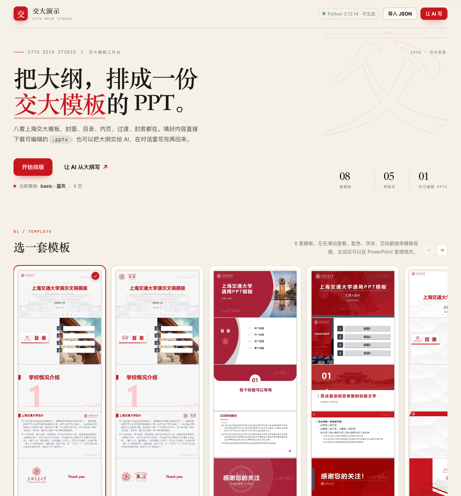
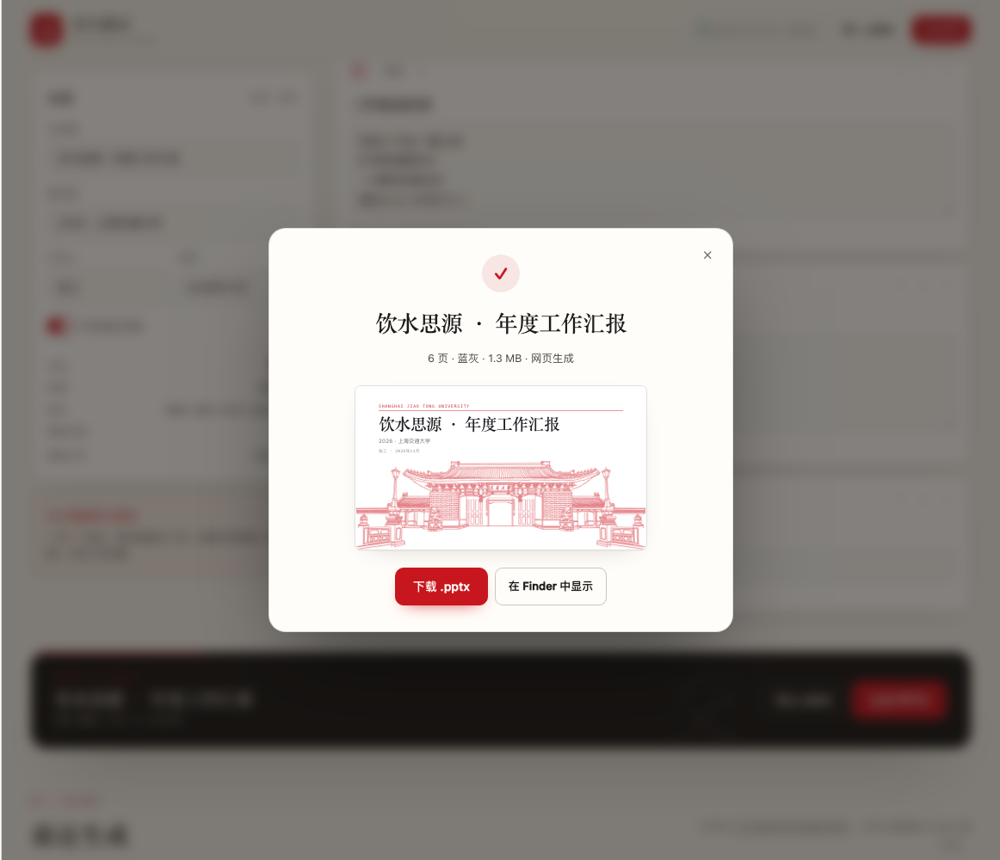

# 交大演示 · dsh-sjtu-ppt

把 **SJTU-PPT-Skill** 的八套上海交大模板装进 DeepSeek Harness：侧栏多一个「交大演示」入口，填封面和页面就能生成可编辑的 `.pptx`；也可以把大纲交给 AI，用随附的 `sjtu-ppt` 技能在对话里写完再回来。

- 左侧栏入口，页面在 iframe 里，明暗跟随 DSH
- 8 套内置模板：basic / 130 / wine / crimson / origin / star / blue / global
- 5 种版式：封面、目录、内页、过渡页、封底
- 可视化编辑封面、目录、内页、过渡页、封底；横向海报条预览整份模板；草稿自动保存
- 生成后可直接下载、在 Finder 中定位；「最近生成」保留历史
- 注册 `sjtu-ppt` 技能和 `sjtu_ppt_generate` 工具，对话里也能生成并交付
- 使用 DSH 桌面版自带的 Python（含 python-pptx），不额外装依赖
- 已在 DSH 0.2.1-rc.5 + python-pptx 1.0.2 下验证：真实侧栏入口、生成、下载、AI 草稿桥接都通过



## 安装

### 从 GitHub 安装（推荐）

仓库：**https://github.com/yourworld2/dsh-sjtu-ppt**

DSH → 左侧 **Plugins** → **Add plugin** → 填上面的地址 → **Install** → 刷新页面。侧栏会出现「交大演示」。

### 从本地目录安装

解压分享包，或直接用仓库目录。在 **Plugins → Add plugin** 里选这个目录：

```
<你存放插件的路径>/dsh-sjtu-ppt
```

安装后确认它出现在该 profile 的组合包列表里（`dsh.profile.bundles`）。侧栏出现「交大演示」即可。

> 开发时可以用 `link:` 装；也可以把仓库打成 zip / tgz 发给同事。

### 手动安装

```sh
cd ~/.dsh/profiles/desktop
node "/Applications/DeepSeek Harness.app/Contents/Resources/runtime/primary-runtime/dependencies/pnpm/bin/pnpm.cjs" \
  add "link:/绝对路径/dsh-sjtu-ppt"
```

然后把 `dsh-sjtu-ppt` 加进 `package.json` 的 `dsh.profile.bundles`：

```json
{
  "dsh": {
    "profile": {
      "bundles": [
        "@deepseek-ai/dsh-base",
        "@deepseek-ai/dsh-web-app",
        "dsh-guizang-design",
        "dsh-sjtu-ppt"
      ]
    }
  }
}
```

有 HMR 时组合包列表变化会直接重组；没有 HMR 时重启 DSH。浏览器端模块在页面刷新后加载。

## 用

### 可视化排版

1. 侧栏点「交大演示」。
2. 选一套模板（模板区横向滑动可看完整 5 页长图）。
3. 填封面：主标题、副标题、汇报人、日期、是否显示页码。
4. 加正文页：目录 / 内页 / 过渡 / 封底；内页每行一条要点，行首两个空格是二级。
5. 点「生成 PPTX」，下载或在 Finder 中定位。



草稿存在浏览器 `localStorage`，下次打开还在。生成的文件在：

```
$DSH_HOME/sjtu-ppt/out/<id>/
```

默认 `$DSH_HOME` 是 `~/.dsh`。

### 让 AI 写

点「让 AI 写」，填主题 / 听众 / 想讲什么，会打开一个新对话，把要求填进输入框（不自动发送）。AI 会用 `sjtu-ppt` 技能，需要时调用 `sjtu_ppt_generate` 工具，把 `.pptx` 放到当前工作区并交给 `present`。

### 在对话里直接用

技能名：`sjtu-ppt`；工具名：`sjtu_ppt_generate`。工具参数：

```json
{
  "template": "wine",
  "content": { "title": "...", "slides": [] },
  "output": "/绝对路径/演示.pptx"
}
```

`output` 建议给当前工作区的绝对路径；不给就落在 `$DSH_HOME/sjtu-ppt/out/`。

## 模板

| id | 名称 | 特点 |
| --- | --- | --- |
| `basic` | 蓝灰 | 校门线稿、红蓝双色，默认款 |
| `130` | 校门红 | 校庆红横线，正式典礼 |
| `wine` | 酒红 | 酒红斜切 + 饮水思源碑实景 |
| `crimson` | 深红 | 红色圆弧、大留白 |
| `origin` | 经典 | 封面 / 过渡页支持图片占位 |
| `star` | 星图 | 星空长曝光 + 暖橙 |
| `blue` | 交大蓝 | 交大蓝 + 粉色线稿 |
| `global` | 国际 | 深蓝切角 + 橙色斜线 |

内置模板没有「左 / 右」占位符，`left` / `right` 双栏字段只对用户自带的 `.pptx` 模板生效。


模板卡片的缩略图在 `web/assets/thumbs/`，文件名与 `skills/sjtu-ppt/assets/*.pptx` 一一对应：`SJTU-wine.pptx` → `SJTU-wine.jpg`。卡片是横向海报条，默认用 `object-fit: contain` 完整展示整张长图（5 页拼接），不裁切；替换同名图片即可换缩略图。

## 内容 JSON

```json
{
  "title": "饮水思源 · 年度工作汇报",
  "subtitle": "2026 · 上海交通大学",
  "author": "张三",
  "date": "2026年11月",
  "page_numbers": true,
  "slides": [
    { "layout": "toc", "title": "目录", "content": ["年度回顾", "关键数据"] },
    { "layout": "section", "title": "年度回顾", "subtitle": "先从三件事说起" },
    {
      "layout": "content",
      "title": "三件做成的事",
      "content": ["完成 A 平台上线", { "text": "移动端占 78%", "level": 1 }]
    },
    { "layout": "end", "title": "谢谢", "subtitle": "Q&A" }
  ]
}
```

封面由顶层的 `title` / `subtitle` / `author` / `date` 自动生成，不需要写进 `slides`。完整字段见插件内 `skills/sjtu-ppt/references/content-format.md`。

## 依赖

插件随 DSH 桌面版使用内置的 Python 运行时：

```
<DSH app>/Contents/Resources/runtime/primary-runtime/dependencies/python/bin/python3
```

已验证 python-pptx **1.0.2**（上游声明 0.6.23，回归测试 33 项全部通过）。如果用的是自定义安装，可以指定：

```sh
export DSH_SJTU_PPT_PYTHON=/path/to/python3
```

页面顶部会显示「Python 3.12 · 可生成」；读不到环境时会变成红色状态，点一下能看到具体原因。

## 开发

```sh
# 静态页面 + 生成接口，不启动 DSH
DSH_HOME=/tmp/sjtu-ppt-preview \
DSH_SJTU_PPT_PYTHON="<DSH 自带 python>" \
node dev/server.mjs
# http://127.0.0.1:5321/sjtu-ppt/

# 回归测试
cd skills/sjtu-ppt && "<python>" scripts/smoke_test.py
```

结构：

```
lib/index.js      Host：skill 提供方、工具、HTTP 路由
lib/skills.js     sjtu-ppt 技能注册与正文注入
lib/tool.js       sjtu_ppt_generate 工具
lib/generate.js   校验内容 → 调 Python → 落盘 / 登记
lib/python.js     找 python-pptx（优先 DSH 自带运行时）
lib/store.js      $DSH_HOME/sjtu-ppt/out 与 meta
lib/templates.js  8 套模板的展示元信息
lib/client.js     浏览器半边：侧栏入口 + iframe + 主题同步
web/              工作台页面
skills/sjtu-ppt/  上游技能的 vendored 快照
```

## 上游与改动

技能与 8 套模板来自 [yourworld2/SJTU-PPT-Skill](https://github.com/yourworld2/SJTU-PPT-Skill)（MIT，模板作者：李一 / 徐臻 / 迮佳 / 沈小丹 / 国际处）。插件内是 vendored 快照，不依赖外网。

为了让插件里的封面和封底更可靠，生成脚本做了几处向后兼容的修补：

- 封面按占位符宽度分配「副标题 / 日期 / 作者」，窄槽只放日期，避免 `张三` 被拆成两行；长标题在窄而高的标题位（wine）按 `·` 分成两行
- 过渡页 / 封底在没有第二个文本占位符时，把副标题缩成小一号追加在标题下方，而不是丢掉
- 封面行只放得下时按字宽缩小字号，不再折行
- 生成后移除未填充的图片占位符，避免导出时出现 `Double-click to add an Image`；origin 的封面 / 过渡图片在新版 python-pptx 下也能正确插入

这些改动只影响生成出来的 `.pptx`，不改变模板本身；33 项 smoke test 仍然全过。

## License

插件代码 MIT。`skills/sjtu-ppt/` 保留上游 MIT 许可，见该目录下的 `LICENSE`。
